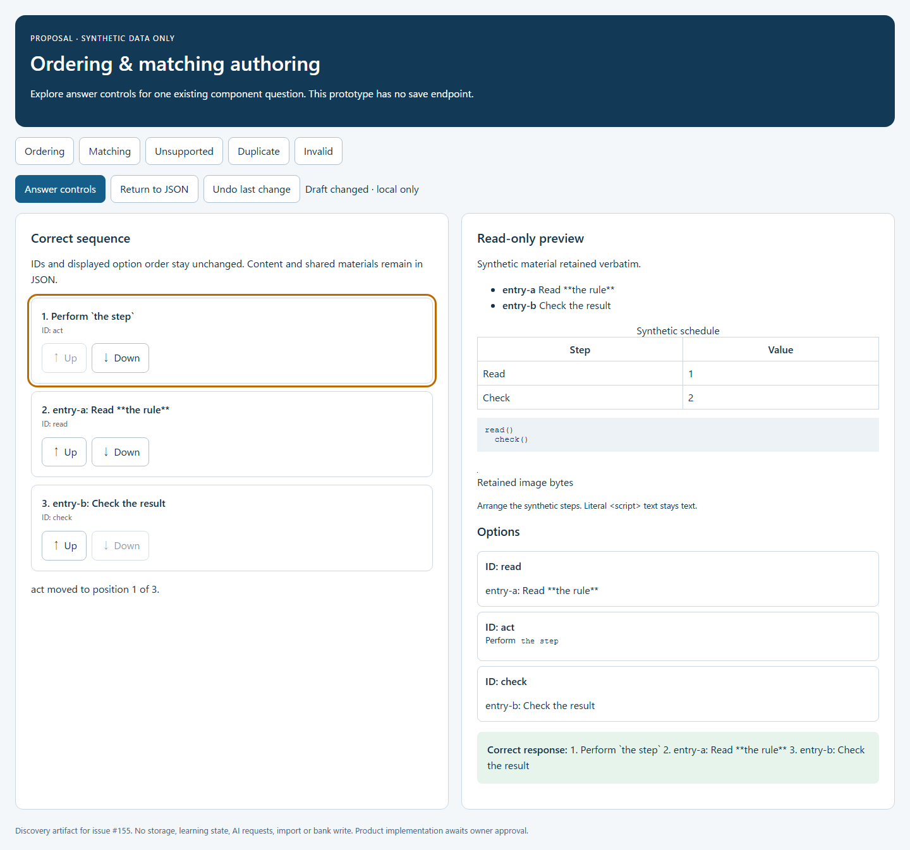
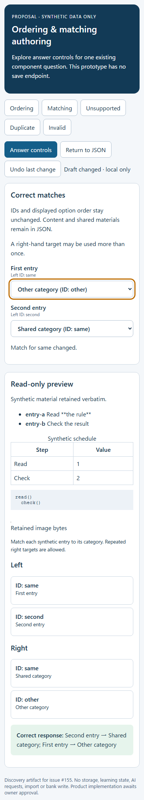

# Ordering and matching authoring: discovery proposal

[Documentation index](../README.md) · [Issue #155](https://github.com/YIzhongyue/PrepDeck/issues/155)

**Status: discovery approved on 2026-10-17; product slice tracked in #166 and #167.**
The original prototype below remains an isolated discovery artifact. The owner
approved existing-item answer controls and separate duplicate-key raw-save
rejection. See the [current authoring guide](../guides/question-bank-authoring.md)
for implemented behavior. Historical discovery statements below describe the
proposal before that decision.

**Original discovery status:** The owner authorized
discovery after #158 merged. This document and its isolated synthetic prototype
do not add a graphical editor to PrepDeck. PRs #143, #147 and #158 are merged;
#151–#154 separately own save/discard, component preview, formatting and recovery.

## Recommendation for the first product slice

Add an optional **Answer controls** view to the existing component editor for
one valid schema 2.0 ordering or matching question. Keep raw JSON as the complete
source and make **Return to JSON** available at all times. Edit only the answer
key: move an ordering answer up/down, or choose a right-hand target for each
matching left item. Display the existing content through the shared renderers.

This helps an administrator correct the sequence or pairing without manually
editing encoded answer strings. It does not create a question from a blank form.
Creation remains the existing component import/JSON workflow; content changes
remain in JSON. This smaller slice avoids inventing rules for deleting options,
repairing references, or flattening a table, figure or combination into a text
field. A later content-form proposal would need a separate scope decision.

The owner can approve this bounded slice, revise it, or leave graphical authoring
deferred. **Merging discovery artifacts is not approval to ship this workflow.**

## Existing contracts and concrete findings

The executable [component schema](../../skills/pdf-to-quiz/references/component-import.schema.json)
and [validator/resolver](../../packages/shared/src/question-components.ts) remain
authoritative. The proposal does not introduce a second schema or scoring model.

| Contract | Consequence for a form |
| --- | --- |
| One interaction and exact scoring per question | No nested questions, partial credit or scoring-method selector. |
| Ordering answers are a permutation of every option ID | Move the answer sequence; never reorder the declaration array or relabel IDs. The schema allows 2–20 options. |
| Matching answers are canonical JSON pair strings, one per left ID | Store `[leftId,rightId]` inside each existing answer string. Every left entry must be covered; a right target may repeat or remain unused. The schema allows 1–20 left and 2–20 right options. |
| Matching IDs are unique within each side | The same ID may exist on both sides. React identity, labels, focus and lookup must include the side. Do not impose new global uniqueness. |
| An option has content blocks **or** list `memberRefs` | Show content through `ComponentContent` and references through shared `optionText`. Do not convert references to copied prose. |
| Stimulus IDs/revisions describe immutable per-question snapshots | Keep material, references, revisions and inline asset bytes unchanged. Editing this question must not update other items. |
| The editor exports a stored question into a one-question package | Its initial source is that editor draft, not the originally imported file. Do not claim original source-file fidelity across storage/export. |

[QuestionContent](../../apps/web/src/components/QuestionContent.tsx),
[ComponentContent](../../apps/web/src/components/ComponentContent.tsx), and
[formatAnswerText](../../packages/shared/src/answerFormat.ts) are reused in the
prototype. It does not mount Learning, a study provider, AI explanation code or
a learner answer interaction. The preview shows current correct-answer prose.

One integration risk is demonstrated deliberately: the existing
`ComponentOptionContent` searches the flattened left/right options by ID. With
a legal cross-side collision it can resolve the wrong side. The prototype passes
each actual option's body directly to `ComponentContent`, and resolves reference
text with `optionText`. A product implementation must retain side-aware identity;
this discovery PR does not change the production renderer.

## Bounded workflows

**Ordering:** open an existing component question → inspect the read-only content
and current correct sequence → activate **Move [ID] up/down** → see the sequence
and shared correct-response summary change → optionally return to JSON → use
the existing explicit Save workflow. Each move swaps only the two answer tokens.
Boundary moves are disabled. There is no drag-only operation.

**Matching:** inspect both content columns → choose a right target with the
labelled selector for a left item → see the shared correct-response summary
change → return to JSON or Save explicitly. The selector shows both readable
content and stable ID, so duplicate text remains distinguishable. Changing one
pair leaves the other pair strings and their array order unchanged. Multiple
left items may select the same right target.

**JSON round trip:** switching modes reads the current source but never
serializes it. Supported valid edits made in JSON appear in the controls. Invalid
or unsupported edits remain editable in JSON with the current diagnostics. The
prototype preserves the mounted textarea's selection and scroll when switching.
A product implementation must also restore focus to the source or selected
control after switching without creating an additional dirty transition.

**Save/discard/recovery:** these controls must feed the editor's existing draft,
dirty baseline, explicit confirmation and optimistic revision mechanisms from
#151–#154. Neither mode switching nor previewing saves anything. Failed saves and
stale recovery retain the entire source. After latest-revision recovery, reassess
form eligibility against the reviewed retained draft; never silently merge remote
and local answers. This prototype intentionally has no Save endpoint and does not
claim persistence or conflict-recovery verification.

## Source preservation and unsupported input

The feasibility adapter keeps the original JSON string, locates value tokens with
the already-installed `jsonc-parser`, and replaces only the intended answer
string tokens. Ordering swaps the original token spellings, including escapes.
Matching serializes only the one intentionally edited pair. No-op matching
preserves outer JSON token escapes. Noncanonical whitespace/escapes *inside* the
decoded pair string already fail shared validation and remain in JSON. An
intentional pair change may use a new outer escape spelling; exact Undo restores
the prior full source, rather than reconstructing its spelling. It never serializes
the whole package, reconstructs options, renumbers IDs or changes numeric values.
No-op actions return the original string. Undo restores the saved source string.

Before controls become available, use strict JSON syntax checking, duplicate-key
detection, shared package validation, the one-question restriction and the
order/match restriction. The prototype demonstrates these checks, rather than
using a tolerant parser's recovered document for editing.

The current raw editor uses `JSON.parse`, which can accept duplicate keys with
the last value winning before normalized persistence. The discovery gate does
not fix or certify that existing save path. #153's token-preserving formatting
also concerns the draft, not new save semantics. Whether to reject ambiguous
duplicate keys at the raw-save boundary requires explicit integration scope;
this prototype has no Save action and never submits such a package.

| Input | Proposed behavior |
| --- | --- |
| Valid rich order/match item, including tables, figures, code and references | Answer controls available; all content is read-only there and editable in JSON. |
| Malformed JSON or invalid references/answers | Preserve source and diagnostics; no answer controls or save of a stale preview. Correct in JSON. |
| Duplicate object keys, including nested keys | Preserve all keys; block controls. Do not select a parsed winner or normalize the document. Explain the ambiguity. |
| Unknown schema version/fields or unsupported interaction/scoring | Preserve the complete source. Explain why controls are unavailable. Do not downgrade, drop fields or silently convert. |
| Multiple-question package | Keep in JSON/import workflow; never choose the first question or discard siblings. |
| Very large, deep or expensive source | Follow the existing editor/import limits. If inspection cannot safely finish, keep JSON and report the limitation; do not guess eligibility. Production performance bounds remain an integration test requirement. |

Preservation has two distinct meanings. **Draft fidelity** is byte-for-byte
outside intentionally replaced tokens (including CRLF, whitespace, escape
spelling, `1.0000`, source metadata and references). **Stored question semantics**
are verified through the existing normalization → export → normalization path:
resolved content, answer mapping, scoring, IDs, stimuli and assets survive.
The existing exporter does not preserve the package-level `source` envelope or
original lexical formatting; the tests explicitly record that boundary. This
proposal does not change the export/storage contract.

The HTML textarea exposes line endings as LF. The model tests prove CRLF token
preservation; browser tests compare the textarea's source before/after mode
switches and edits. They do not mistake browser line-ending normalization for a
serialization pass.

## Keyboard, touch, validation and preview

- Use native buttons and selects with visible labels and stable side/ID identity.
  Controls have at least 44 × 44 CSS-pixel targets; a pointer drag is never needed.
- An ordering move keeps focus on the moved answer row and announces its new
  position through a polite status. A matching change keeps focus in its selector.
  Tab/Shift+Tab and native select keyboard behavior remain available.
- Show IDs next to content; do not use color as the sole signal. The existing
  correct-response summary gives a readable confirmation of the entire key.
- Preserve the editor's narrow Edit/Preview behavior. This isolated prototype
  stacks controls and preview at 390px to review the content/interaction boundary;
  it is not a replacement drawer layout. Its JSON field scrolls internally.
- Use the shared validation paths/messages. When invalid, use #152's explicitly
  stale preview and error-navigation contract after integration, rather than
  saving retained preview data. The prototype clears its preview on invalid input
  to avoid implementing that pending product behavior twice.
- Shared material and the full left/right option content must remain inspectable.
  Answer summaries are not a substitute for figures, table cells or code blocks.

Automated keyboard and touch checks are included. Screen-reader speech, real
touch-device use, and usability with an administrator have not been evaluated.
Those are owner-review/integration limitations, not claims of completed testing.

## Synthetic prototype and executable evidence

All files are under [component-authoring/](component-authoring/). They are excluded
from the app entry point and router. The server binds only to loopback, bundles in
memory, serves synthetic examples and has no write API, storage or external calls.

From the repository root with Node 24 and `npm ci` complete:

```sh
node --test docs/proposals/component-authoring/model.test.mjs
node docs/proposals/component-authoring/prototype.browser.mjs
node docs/proposals/component-authoring/server.mjs --serve
```

The last command prints a temporary `127.0.0.1` URL for human review; stop it with
Ctrl+C. Set `PLAYWRIGHT_BROWSERS_PATH`, `BROWSER_EXECUTABLE` or `PLAYWRIGHT_MODULE`
if needed. Set `SCREENSHOT_DIR` for local browser captures. The preservation tests
also run through `apps/web/scripts/component-authoring-discovery.test.mjs` in
normal web CI. The prototype browser check is an explicit discovery command.
The example buttons deliberately replace the synthetic example and reset its
history; they are not a demonstration of product navigation/discard behavior.

The nine preservation tests cover rich valid fixtures, two-token ordering edits,
inverse/no-op byte identity, escaped token spelling, many-to-one matching,
cross-side ID collisions, reversed pair-array order, real normalization/export,
malformed/unsupported/duplicate input, missing references and refused actions.
The browser script checks keyboard and touch moves, readable preview changes,
native matching selection, Undo, mode-switch caret/scroll, unsupported recovery,
rich renderers, 390px overflow, empty storage and absence of API/external requests.

Local verification on 2026-10-17, Windows, Node 24.19.0 and Chromium
153.0.8010.12: all nine preservation tests and repository lint passed. The browser
check passed at 1440 × 1000 and 390 × 1000 with touch enabled for the phone case.
It observed zero page errors, external requests, API calls or storage entries.
Screenshots were inspected for readable labels, visible focus, full shared
material and unclipped controls. These are synthetic discovery evidence, not
screenshots of a shipped editor.

| Ordering at desktop width | Matching at phone width |
| --- | --- |
| [](component-authoring/screenshots/ordering-1440.png) | [](component-authoring/screenshots/matching-390.png) |

## Product implementation acceptance criteria for owner review

1. Support exactly the bounded existing-item order/match answer-editing workflows
   above. Document all exclusions in the UI/help. Add no automatic conversion.
2. Keep a single raw draft source. Mode changes/no-ops preserve exact bytes and
   dirty state. Answer edits alter only intended tokens; source, IDs, content,
   references, number spelling, metadata and declaration order remain intact.
3. Preserve complete permutations and canonical matching pairs; allow repeated
   right targets and side-local duplicate IDs. Use shared schemas and summaries.
4. Use existing renderers with side-aware identity. Show the correct rich content
   and answer labels at desktop, 390px and zoom-equivalent widths without overflow.
5. Unsupported/invalid/ambiguous input remains available in JSON with diagnostics;
   answer controls never filter, downgrade, submit it or overwrite it with a
   preview. Record the duplicate-key raw-save policy explicitly before integration.
6. Integrate #151–#154's focus, dirty confirmation, pending guards, explicit Save,
   stale preview and conflict recovery without a second baseline or shortcut.
7. Add integration regressions for no-op mode switches, edits in both modes,
   failed/stale saves, repeated revision saves, discarded/cancelled changes,
   option-ID collisions, min/max counts and large-source bounds. Verify current
   Worker grading and stored-question semantics with synthetic local fixtures.
8. Verify keyboard-only, touch, labelled controls, focus restoration, status
   announcements and assistive-technology speech. Rendering must make zero
   learning writes, AI requests or incidental correct-answer mutations.

**Excluded:** blank-form creation, block or option add/remove/rename, stimulus or
asset editing, one-to-one matching enforcement, drag-and-drop, partial credit,
nested interactions, schema changes, automatic formatting, migrations, deployment,
production content and changes to learner rendering semantics.
