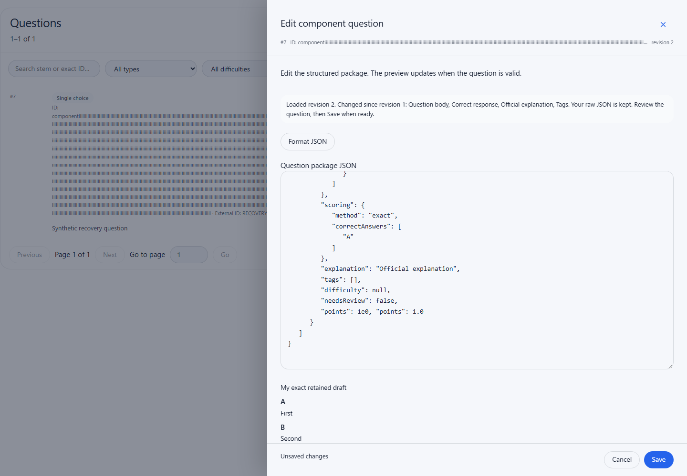
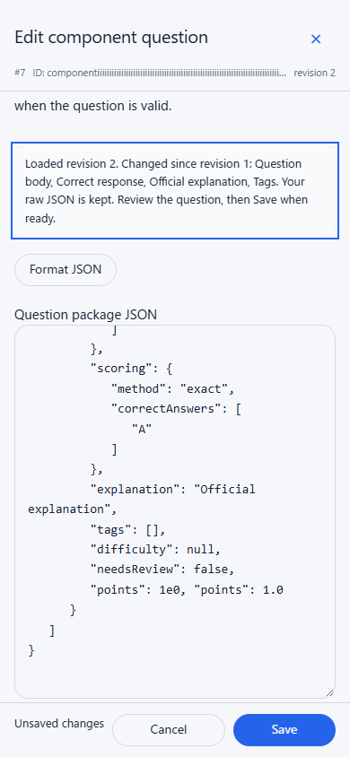
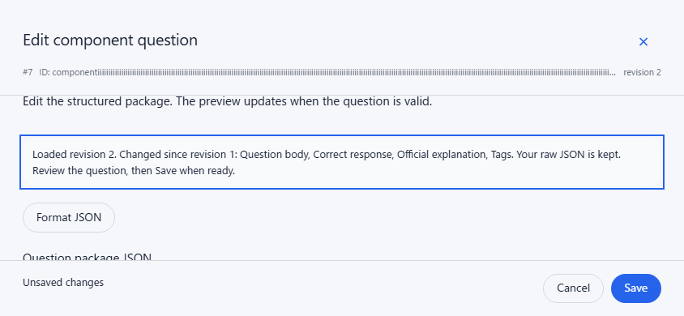

# Component drawer and revision recovery

Issue [#154](https://github.com/YIzhongyue/PrepDeck/issues/154) gives the component
editor an identifying header and explicit revision recovery. The user behavior
is owned by the [question-bank authoring guide](../guides/question-bank-authoring.md).

The dedicated `apps/web/scripts/component-stale-recovery.browser.mjs` fixture
uses the actual Questions panel, editor, shared draft guard, parser, exporter
and renderer with a synthetic loopback HTTP server. Verified with Chromium
153.0.8010.12 on Windows and Node 24.19.0; no other browser engine was run for
this dedicated fixture. It verifies:

- Sequence, bounded internal ID, revision and reachable Close/Cancel/Save at
  1440×1000, 390×844 and 844×390, including 5,000-character IDs.
- Exact raw-text retention, including whitespace, duplicate keys and numeric
  spellings when loading latest and keeping edits; ordinary Save retains the
  existing persistence normalization. Failed GET and real export-validation
  failure preserve the old revision and retry actions.
- Only `409 stale_question` offers recovery; duplicate-ID conflicts and other
  failures do not. Reloading issues no PATCH, and each explicit Save sends the
  currently loaded revision. A second concurrent edit conflicts again.
- Invalid retained drafts keep the last valid preview and focus current errors
  without saving. Confirmed discard reloads the saved package; cancelled discard
  retains text and returns focus without a GET.
- Pending GET/PATCH blocks dismissal, navigation and duplicate keyboard saves.
  Pending requests and failure feedback retain focus inside the modal. The shared
  keyboard/discard behavior and formatter remain in use.
- Actual panel focus after Save/list refresh, including a filtered-away row,
  current opening-control focus after a clean Close, and no later focus stealing
  when the user moves to another control during a delayed list refresh.
- Automated WCAG A/AA checks on the recovered drawer. This does not substitute
  for manual screen-reader testing.

Run locally with `node scripts/browser-regressions.mjs component-stale-recovery`.
Set `SCREENSHOT_DIR` to an existing writable directory to capture the states
below. All content is synthetic; no production service is contacted.

