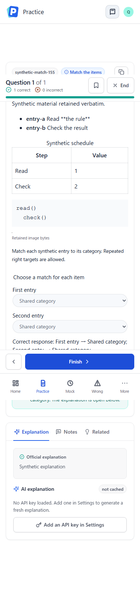
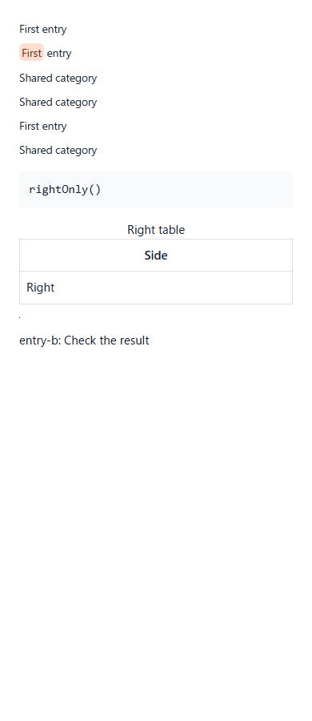

# Matching side identity verification

[Documentation index](../README.md) · [Issue #172](https://github.com/YIzhongyue/PrepDeck/issues/172)

## Impact correction

The initial concern from #170 described a learner rendering defect. Inspection
and a synthetic local-browser reproduction on master
`e54f705e6fd724977ff7c7fcc55770275110106c` narrowed it to the shared rich-content
component API: `QuestionContent` and `ComponentOptionContent` flattened both
matching sides and selected the first matching ID. They could not address the
right item when its ID also existed on the left.

Current Learning, Practice and Mock screens already use the side-aware
`StructuredResponse`. The component editor preview already renders concrete
options from each side. The import preview renders the normalized left-column
projection plus a side-aware answer summary. All these paths passed with a
cross-side collision. No live learner-screen defect or incorrect grading was
reproduced. Adding rich matching controls to those screens is outside this fix.

The narrow repair adds `matchingSide="left" | "right"` to the two shared
components. Omission selects the existing left projection. Both the Markdown
source comparison and the rich-block/member-reference lookup use that side.
Missing IDs do not fall back to the other side. Current production callers
continue to render the left projection; the new explicit-right API is covered
directly in the harness rather than presented as a new product flow.

## Reproduction and regression

`apps/web/scripts/matching-side-content.browser.mjs` uses only synthetic data
and an isolated loopback HTTP fixture. It validates the package, mounts real
screens/provider and the editor/import dialogs, then exercises the shared
components directly. The fixture has left `same = First entry`, right
`same = Shared category`, and two left items targeting right `same`.

Against the unchanged renderer, the first explicit-right assertion failed:

```text
AssertionError: an explicit right-side render must not select the colliding left item
actual:   First entry
expected: Shared category
```

There was no side parameter before the repair; the regression supplies the
proposed parameter, which the old component ignores. The red-before result
establishes the new shared-component contract; it is not a reproduction of a
pre-existing live learner regression or evidence of an existing production
caller requesting the right side incorrectly.

Independent review found that the original negative annotation assertion used
backend DTO fields directly in component props. Those annotations were filtered
out before rendering, so that assertion was vacuous. The corrected fixture uses
frontend `Annotation` fields (`qid`, `target`, `start`, `end`) and passes the same
annotation to both a matching left-source positive control and the mismatched
right source. The positive control failed with the old DTO shape (zero marks
instead of one). It now requires exactly one highlighted `First` span at source
offset zero; the right source must show `Shared category` without that mark.
This correction changes test evidence, not production annotation behavior.

The regression checks:

- Cross-side ID reuse and many-to-one answers validate; same-side duplicates fail.
- Learning, Practice and Mock retain the correct left label and right choices.
  Keyboard selection, Practice submission and persisted Mock draft payloads
  preserve canonical `[leftId,rightId]` strings.
- Editor answer controls and editor/import previews remain correct without
  saving or executing an import.
- Explicit sides, the default left projection, missing right IDs, Markdown
  source matching, the positive/negative annotation controls, code, table,
  decoded figure and member references resolve correctly without mutating the
  source data.
- Desktop (1280px) and phone-width (390px) browser viewports pass.

Run with `node apps/web/scripts/matching-side-content.browser.mjs`, or the
registered runner `npm run test:browser -- matching-side-content`. Optional
`PLAYWRIGHT_BROWSER=webkit` selects WebKit; `SCREENSHOT_DIR` captures evidence.

## Local evidence

Captured on Windows with Node 24.19.0, Chromium 153.0.8010.12 and Windows
Playwright WebKit 26.6 on 2026-10-17. These are browser viewport, DOM, native
keyboard and request-payload checks. They are **not** screen-reader speech tests,
physical iPhone/Safari tests or production validation. Browser access is limited
to the loopback fixture; existing Google Fonts requests receive an empty local
response.

The learner screen below is a preservation check, not a before/after UI change.



The direct component harness below renders the left projection, the highlighted
left positive control, right Markdown, right content with a mismatched source,
a missing right ID (empty), explicit left, right rich blocks and right member
references in that order. The pixel figure is deliberately one pixel; the test
checks successful image decoding.



## Compatibility and rollback

No schema, scoring, API/import formats, stored data, editor behavior or learning
flow changes. Existing ID-only production callers project the left side; callers
that need a right item must specify the side. The main regression risk is
resolving the Markdown shortcut and rich renderer against different sides.
Reverting the frontend commit rolls back the repair without a migration.
