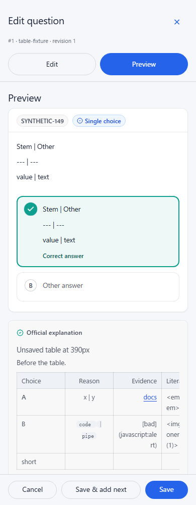
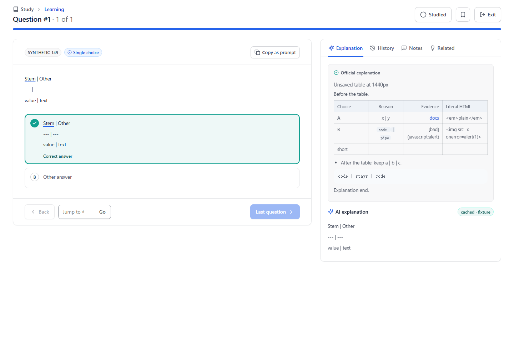

# Official explanation tables

[Documentation index](../README.md) · [Authoring guide](../guides/question-bank-authoring.md)

Official explanations use the existing opt-in Markdown pipe-table renderer in
the standard editor's unsaved preview, Learning, and graded Practice. The shared
official-content component enables the option; stems, options and AI explanations
keep their existing rendering. This implements [#149](https://github.com/YIzhongyue/PrepDeck/issues/149).

Tables have semantic column headers and cells, left/center/right alignment,
escaped pipes, inline formatting, and padding for short rows. Wide tables scroll
inside the explanation. Supported surrounding Markdown blocks keep their text;
this does not add a new Markdown dialect or raw HTML support. The source is saved
as Markdown, with the same source coordinates used by the existing renderer.

## Local verification

The fixture uses synthetic content and a loopback API. It mounts the real standard
editor without a study provider, then the actual Learning and graded Practice
screens with an isolated test context. No production account or data is used.

```sh
node scripts/browser-regressions.mjs official-explanation
```

At 390px and 1440px it edits an unsaved table, previews, saves and reopens it, then
compares the official content with Learning and Practice. Assertions cover table
semantics and alignment, escaped pipes, short rows, surrounding lists/code/prose,
safe links, literal HTML, exact span offsets, retained stem/option annotations,
and internal horizontal scrolling without page overflow. AI/stem/option table
syntax stays on its existing rendering path. The unit regression also checks
non-table rendering parity and source-coordinate annotations before/inside/after
tables.

## Synthetic screenshots




