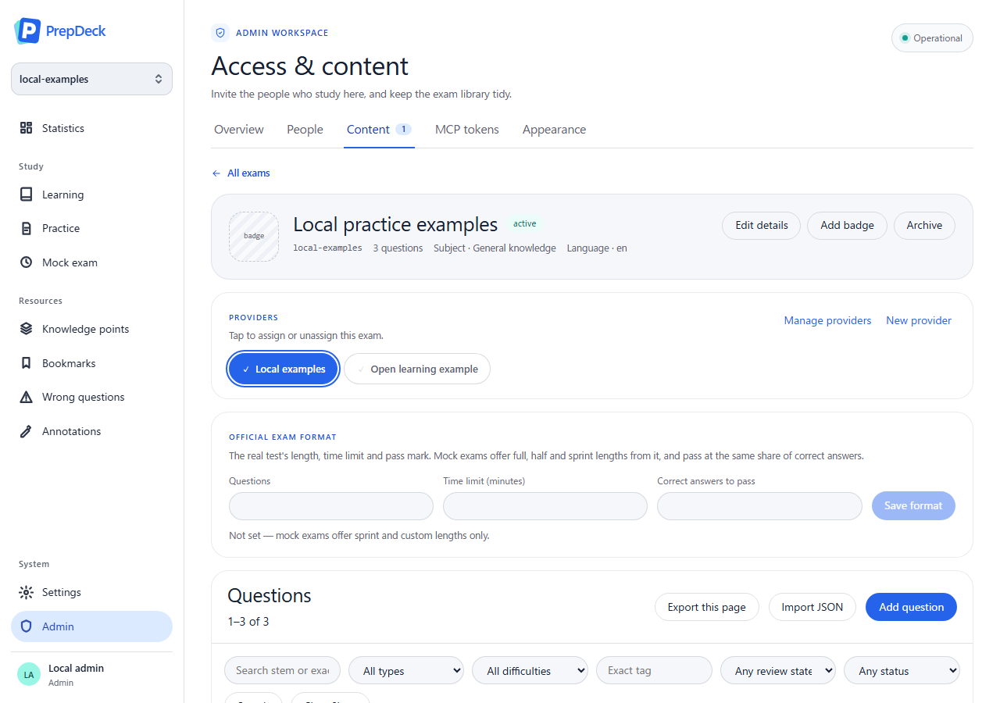
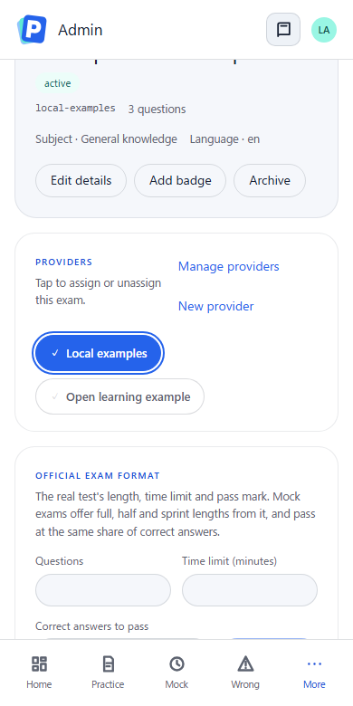

# Provider assignment accessibility

[Documentation index](../README.md) · [Provider behavior](../requirements/question-bank-management.md#provider-management) · [Issue #136](https://github.com/YIzhongyue/PrepDeck/issues/136)

The provider controls in **Admin → Content → exam → Providers** remain native
toggle buttons. `aria-pressed` follows the existing confirmed assignment state;
the decorative checkmark is excluded from the accessible name. Provider names
remain stable when assignments change. No assignment API or save behavior changes.

## Browser regression

`npm run test:browser -- admin-console` drives the real app shell against a
synthetic HTTP fixture. At 1280 × 900 and 390 × 780 it verifies:

- Assigned and unassigned states in Chromium's accessibility tree, with exact
  provider names and no checkmark in the name.
- Tab and Shift+Tab navigation, Space/Enter activation and pointer activation.
- Delayed assignment and unassignment requests: the confirmed state remains
  unchanged while the request is pending.
- Successful PUT/DELETE updates and failed PUT/DELETE requests retaining the
  previous state and focus, with one request per activation.
- No horizontal overflow in either viewport.

## Screen-reader verification boundary

Verification used Node.js 24.19.0 and Playwright's Chromium 153.0.8010.12 on
Windows. Windows Narrator 10.0.26100.8972 is installed; Chrome 155.0.8059.84 and
Edge 155.0.4283.45 are also installed. NVDA and JAWS were not found in the inspected
standard installation locations. This automation session does not expose the
native Windows control/speech-capture interface required to operate and observe
Narrator. Actual screen-reader speech testing could not be performed.

The assertions above inspect Chromium's accessibility tree. They do **not**
establish what Narrator, NVDA or JAWS announces. Before acceptance, a human can
focus each provider button, confirm its name and pressed state, then use Space
and Enter and verify the new state. A failed request should leave the previous
state announced when the button is refocused.

## Local validation results

On 2026-10-17, the following passed in the isolated provider-assignment worktree:

- `npm run lint` and `npm run typecheck`.
- `npm run test:browser -- admin-console` (13 seconds).
- Worker tests: 584 passed. Shared tests: 67 passed.
- `npm run build --workspace apps/web` (existing large-chunk warning only).
- `npm run test:local:smoke -- --browser`, including local resource checks,
  actual browser navigation and the full five-theme accessibility scan.
- Direct verification of the Worker-served bundle: authenticated local admin,
  synthetic provider data, keyboard and pointer assignment changes persisted
  to local D1, a locally injected 503 retaining state/focus, and both screenshot
  widths. The synthetic extra provider was removed afterward.

The ordinary workspace test command exposed two existing Windows-specific
renderer test-loader failures in `markdown-tables.test.mjs`: dynamic imports
received a drive-letter path instead of a file URL (`ERR_UNSUPPORTED_ESM_URL_SCHEME`).
The complete web suite then passed all 143 assertions using an ignored temporary
Node import hook that converts Windows absolute paths to file URLs. The tests
and assertions were unchanged; the adapter is not part of this change.

## Local application screenshots

These screenshots use the final Worker-served web build and only synthetic
local test content. The assigned and unassigned providers retain their existing
appearance, and the focused assignment retains a visible focus ring.

