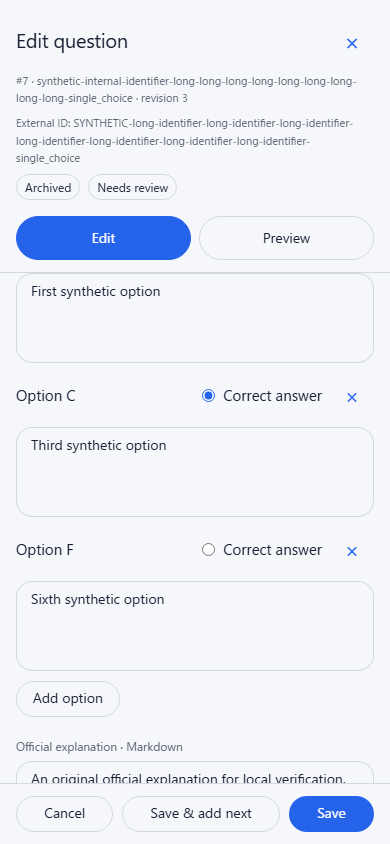
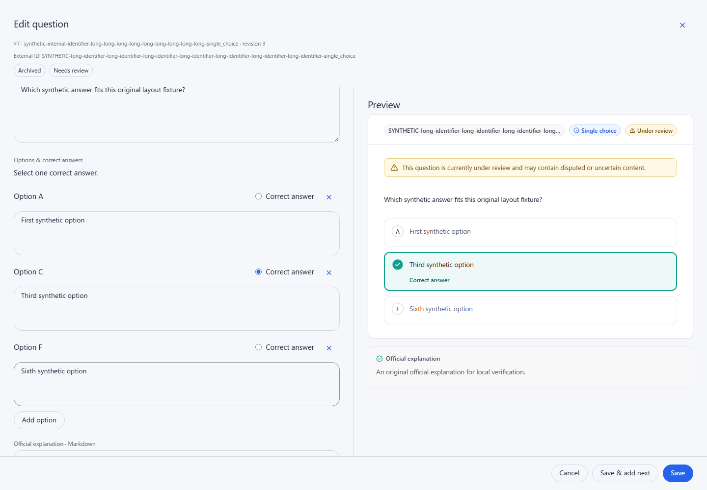
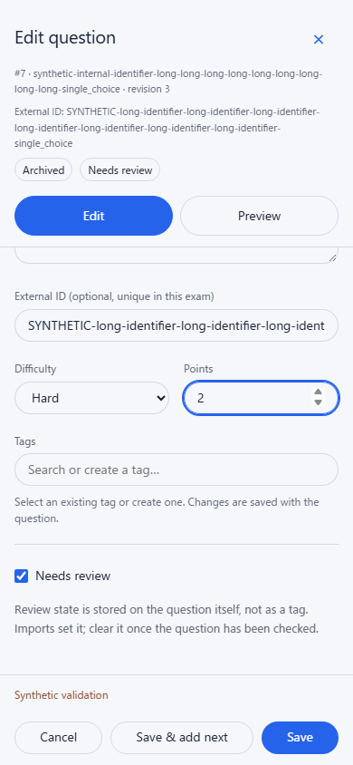

# Standard question editor fields

[Documentation index](../README.md) · [Authoring guide](../guides/question-bank-authoring.md)

Issue [#150](https://github.com/YIzhongyue/PrepDeck/issues/150) improves the standard
editor's fields and header context. These captures use original synthetic
questions and a dedicated loopback fixture, without a deployed question bank.







The header shows the loaded internal ID/revision and archive state, alongside
the draft External ID and review flag. Option textareas resize without replacing
their DOM nodes, rewriting values or changing answer IDs. The metadata capture
also retains the existing general alert from a synthetic rejected save after
its option-specific error has been corrected.

Reproduce with:

```sh
npm run test:browser -- question-editor-fields question-editor-preview question-authoring question-draft-preview
```

Set `SCREENSHOT_DIR` to capture fresh images. The fields fixture checks all four
standard types at 390×844, 1440×1000, 844×390 (short landscape) and 720×500 CSS
pixels (the last is the reflow equivalent of 200% zoom on a 1440×1000 display).
It checks growing/shrinking
options, live wide/phone reflow, selection/focus and pane scroll retention,
visible associated answer labels, 44×44 removal targets, stable IDs and Undo,
field-error association, long identifiers, draft header status, metadata reflow
and saved payloads. Adjacent suites retain lazy preview mounting, component
diagnostics and existing authoring/recovery coverage.

Local Chromium screenshots demonstrate visual layout and browser assertions
check DOM accessibility relationships; they do not represent screen-reader
speech testing.
