# Question editor preview proximity

[Documentation index](../README.md)

## Learning card presentation (#148)

The approved first slice of [#148](https://github.com/YIzhongyue/PrepDeck/issues/148)
replaces the standard editor's plain preview with Learning's read-only question
card. Correct options use the shared `OptionGroup`/`OptionRow` list semantics and
visible **Correct answer** text. Fill-in questions display every accepted answer.
The official explanation shares Learning's pure renderer and is expanded in the
editor. All content comes from the unsaved form. Interactive try-answer and
explanation-table support are outside this slice.

The editor does not mount `LearningLive`, a study provider, or the AI-backed
`ExplanationPanel`. Component-question preview/diagnostics and the responsive
pane lifecycle described below remain unchanged. The
[authoring guide](../guides/question-bank-authoring.md) owns the user workflow.

Run the following to reproduce the local browser checks. The runner executes
the scripts sequentially; `SCREENSHOT_DIR` retains captures.

```bash
npm run test:browser -- question-draft-preview question-editor-preview question-authoring question-content question-card-layout answer-state component-annotations
```

The new `question-draft-preview` fixture runs the real editor without a study
provider, against a loopback-only synthetic API. A separate browser page renders
the real Learning screen with a frozen test snapshot and action spies for
comparison. Across single choice, multiple choice, true/false and fill-in at
390px and 1440px, it verifies:

- Exact stem, option/accepted-answer and official-explanation markup parity,
  plus computed answer styling parity with Learning.
- Unsaved edits to every displayed content/answer field, multiple correct
  answers, literal Unicode/Markdown fill-in alternatives and preserved whitespace.
- Expanded long explanations, incomplete drafts, no horizontal overflow,
  successful explicit save and clean reopen.
- No study context use, AI/learning requests, extra writes, source-question
  mutation, local-storage changes or dirty state from preview interactions.

The unchanged responsive suite covers lazy first mount, retained subtree,
focus/caret/edit and preview scroll, keyboard switching, 1100/1099px boundaries,
390px and 720px zoom-equivalent reflow, client/server validation, Undo, stale
recovery, interrupted saves and cancellation. Adjacent suites cover component
JSON diagnostics and import preview, Learning/Practice/Mock presentation, answer
state, annotations and content loading.

These screenshots were captured and inspected with Chromium 153.0.8010.12 and
Node.js 24.19.0 on Windows using synthetic data only. External requests are
blocked in the new fixture, so hosted fonts use system fallbacks. This evidence
does not claim production verification or screen-reader speech testing.

Local verification passed lint, all workspace type checks, the web build,
584 Worker tests, 67 shared tests, 150 web tests, the three browser-runner tests
and the seven browser suites above. The unmodified web test command encounters
two existing Windows file-path import failures in `markdown-tables.test.mjs`;
all 150 pass with a temporary, ignored Node resolver converting drive-letter
imports to file URLs, without changing assertions. Linux CI runs the ordinary
command. The new browser regression was also run against the original master
editor and failed because the Learning card markup was absent; the implementation
was restored afterward. There are no API, migration or deployment changes.

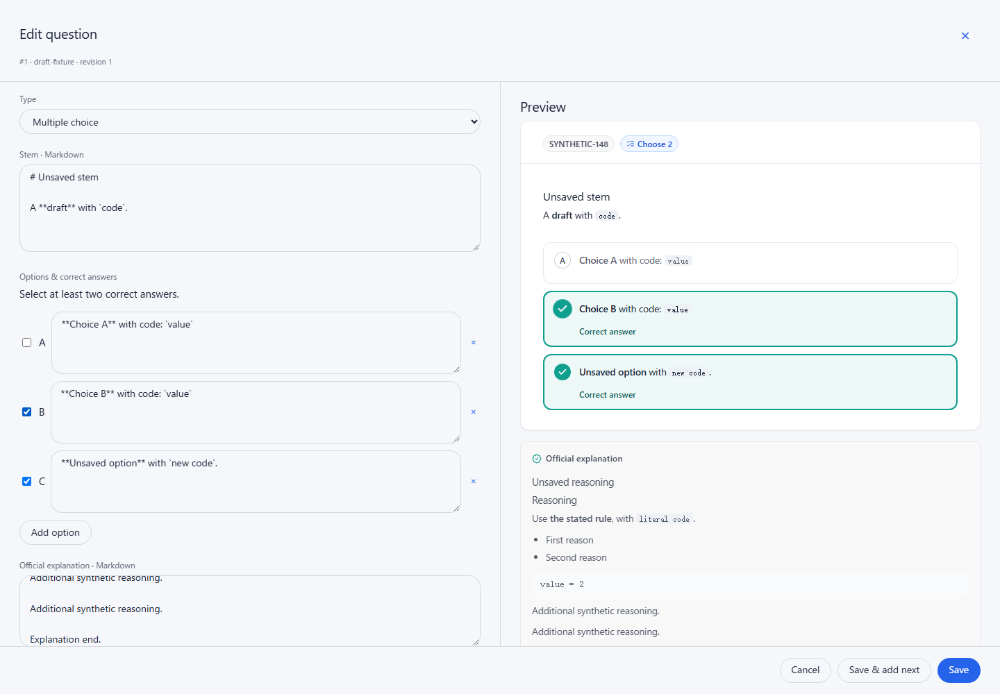

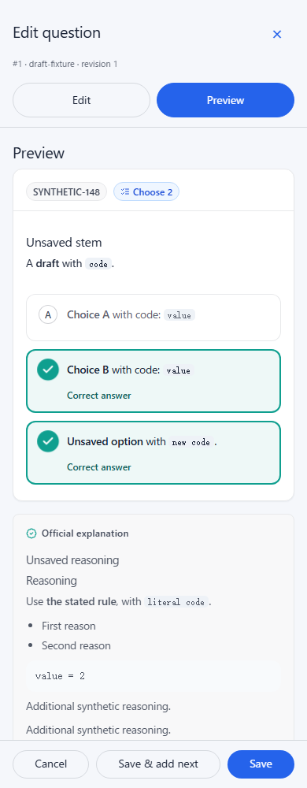

## Earlier pane layout and lazy mounting

Partial progress on [#138](https://github.com/YIzhongyue/PrepDeck/issues/138).
This change only moves the existing Markdown preview beside the fields or behind
an explicit view switch. It does not change the component/JSON editor, learner
rendering, Markdown support, save semantics or keyboard shortcuts.

## Before

Reproduced on master `3b014d0c195dd8a209c293ce975f0a75fb5f11a6`
using the actual editor, an isolated loopback fixture and original synthetic
content. At 1440 × 1000 CSS pixels, **Show Markdown preview** left the preview
below every field, starting at y=1196. Scrolling it into view moved the drawer
body to scrollTop=1859; the fields and preview could not be reviewed together.

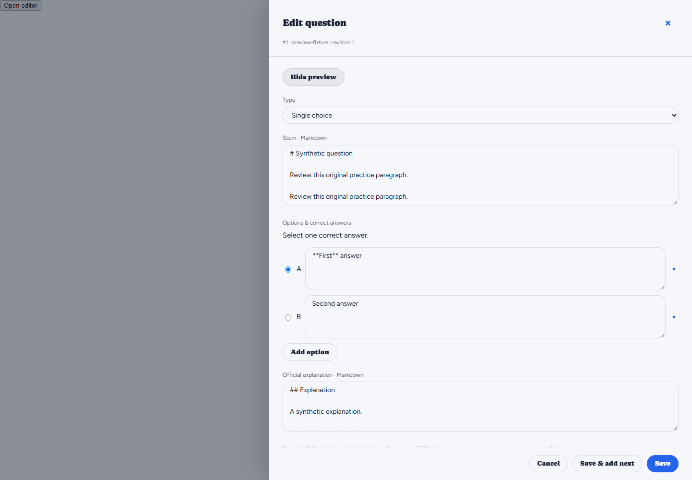

## Responsive layout

The drawer uses two independently scrollable panes at 1100 CSS pixels and above.
At that boundary each pane has roughly 494px of usable width. Below it, Edit and
Preview buttons remain in the header while the current pane scrolls. Both pane
containers stay mounted; preview children first mount on Preview activation or
wide layout, then stay mounted. Draft values, textarea selection and scroll
positions survive switching. Returning to Edit focuses the last edited control. Invalid saves
reveal the affected fields, and resizing keeps the focused pane available.

The breakpoint is based on space for the existing fields and preview; it is
not a new platform-wide breakpoint. Save, Save & add next, Cancel, Escape,
unsaved-navigation protection, Undo and stale-version recovery retain their
existing behavior. No migration or API change is needed.

## Reproduction

Run `npm run test:browser -- question-editor-preview question-authoring`.
Set `SCREENSHOT_DIR` to retain images. The preview test covers long content,
live rendering, 1100/1099/390px layouts, 720px zoom-equivalent reflow, repeated
switching, caret/focus/edit and preview scroll retention, keyboard navigation,
client and server field validation from Preview (including draft retention and
focus on the rejected field), Undo,
conflict recovery, a delayed failed save, cancellation and eventual successful
save. The authoring suite preserves the broader regression coverage from #140.

The automated fixture's 720 × 500 viewport models the CSS-pixel space of a
1440 × 1000 window at 200% zoom. Separately, the final Worker-served build was
tested using Chromium's actual tab zoom at 100% → 200% → 100% in a temporary
isolated test profile. `chrome.tabs.getZoom` confirmed factors 1 → 2 → 1 and
the page's `innerWidth` changed 1440 → 720 → 1440. The compact controls,
draft and focus survived the round trip. The temporary extension/profile was
used only for this check; no user browser settings were changed.

## Final local verification

Verified on Windows using Node.js 24.19.0 and Chromium 153.0.8010.12.

- Passed lint, workspace type checks, web build, 584 Worker tests and 67 shared
  tests. The ordinary workspace command hit two existing Windows dynamic-import
  path failures in `markdown-tables.test.mjs`; all 143 unchanged web tests passed
  with an ignored temporary hook converting drive-letter paths to file URLs.
- Passed `question-editor-preview`, `question-authoring` and `question-content`
  browser regressions. The existing authoring suite includes #140's validation,
  stale recovery and Undo checks and the unchanged component editor flows.
- Verified the final Worker-served build using a dedicated local admin and
  synthetic content: wide/390px layouts, repeated switching and caret/focus
  retention, validation from Preview, injected local 503 draft retention,
  cancelled discard and a successful save persisted in local D1. The test
  question was deleted afterward.
- Actual 200% browser zoom verified as described above. Screenshots and final
  diff inspected; independent read-only code review found no remaining defects.

No deployed bank, production service or private repository was accessed. No
screen-reader speech testing is claimed. Rollback is a single commit revert;
there are no schema, API or configuration changes.
The local built-app screenshots block external requests, so hosted fonts fall
back to system fonts; this change does not alter the application's fonts.

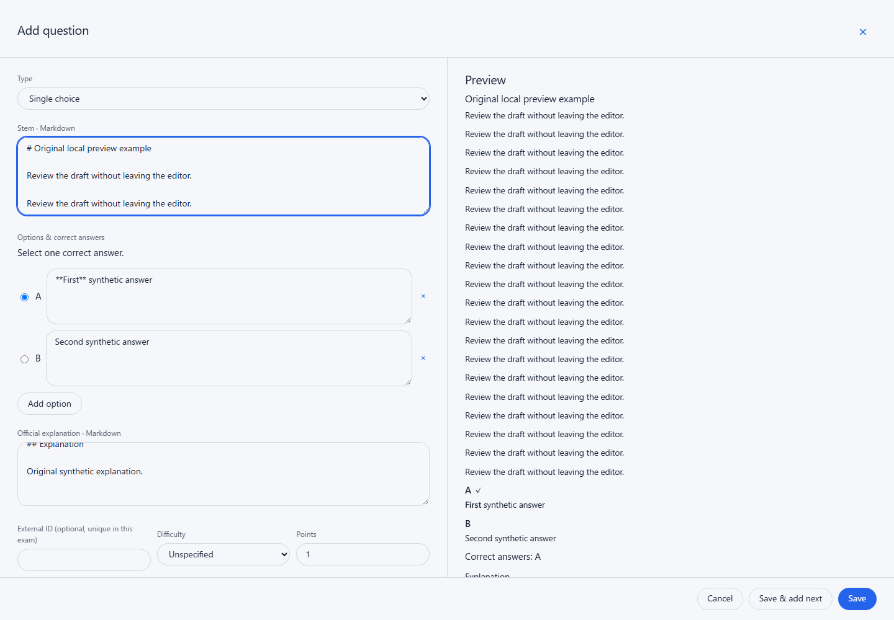

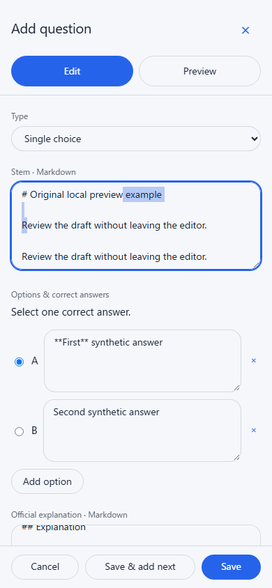

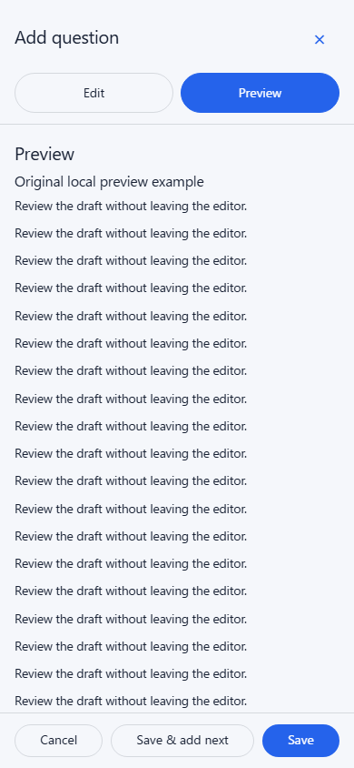

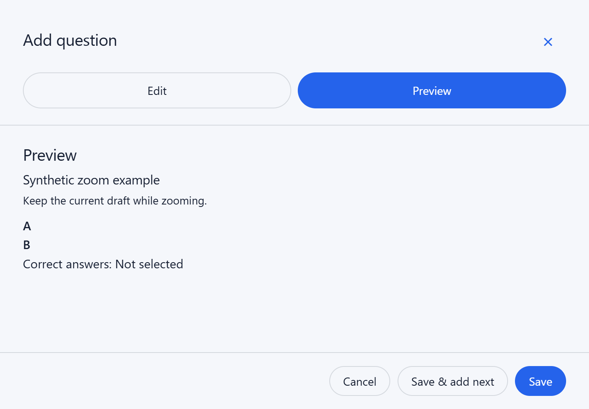

## Compact initial preview mounting (#156)

[#156](https://github.com/YIzhongyue/PrepDeck/issues/156) corrects unnecessary
hidden rendering introduced by #143. On a compact opening, the preview section
and its ref remain stable but its children wait until first Preview activation or
a wide layout. After that first use the children remain mounted, preserving
preview scroll across switches and resizing. Markdown output, save workflow,
validation, Undo and stale-save recovery are unchanged.

The regression instruments the real `QuestionContent` and Markdown parser in the
test bundle only. It failed on unchanged master `4ca4175`: a compact opening
called each implementation four times instead of zero. With the correction it
passes with zero calls and zero preview child elements on opening and edits
before first use. First activation displays the latest stem, options and
explanation. Fresh wide openings and widening before first Preview also pass,
and child-node identity survives later switches and resizing.

### Matched synthetic comparison

The same synthetic inputs and instrumentation were run before and after the fix
with Chromium 153.0.8010.12, Node 24.19.0 and production React 19.3.0. Each run
covered three fixture shapes, two widths and three repetitions: 18 openings and
135 measured phases. Fixtures passed the existing validator initially and after
every measured edit. The earlier measured standard editor at `dfcff58` is
identical to master `4ca4175`; the corrected product commit is `2e0c125`.
Unchanged renderer source hashes and fixture dimensions were compared.

For the fragmented near-limit fixture (19,992-character stem, twenty
10,000-character options and a 50,000-character explanation), at 390px:

| Phase | Markdown calls before → after | Preview elements before → after | Event-to-two-frames median, ms, before → after |
| --- | --- | --- | --- |
| Open (3 samples) | 22 → 0 | 36,079 → 0 | 489.00 → 202.50 |
| Edit before Preview (12 samples) | 22 → 0 | 36,080 → 0 | 115.35 → 27.35 |
| First Preview (3 samples) | 22 → 22 | 36,080 → 36,080 | 257.30 → 534.90 |
| Edit after first Preview (6 samples) | 22 → 22 | 36,080 → 36,080 | 114.45 → 120.15 |

The deterministic result is removal of work before compact activation. Rendering
cost moves to first Preview. These sequential, instrumented, headless desktop
timings are descriptive; they are not phone latency, production INP or a general
speedup guarantee. Textarea/layout work, caches, run order and system load affect
them. No timing threshold, rendering cache or scheduling redesign is included.

### Verification of the correction

- Lint, workspace types, web-only build, 584 Worker tests, 67 shared tests and
  143 web tests passed sequentially. The web run used the same ignored Windows
  file-URL resolve adapter described above, without changing test assertions.
- `question-editor-preview`, `question-authoring` and `question-content` browser
  suites passed. The preview regression exercises client/server validation,
  Undo, stale recovery, interrupted save, dismissal protection and keyboard
  navigation after compact first activation, as well as focus/caret/scroll and
  1100/1099/390px layout transitions.
- Full local smoke and the five-theme axe-core 4.14.0 scan passed. A separate
  built-app check against local Worker/D1 verified the initially empty preview,
  latest draft, stable section, repeated switching, real concurrent-edit
  rejection/recovery, injected local save failure and successful fresh-revision
  persistence. Its disposable synthetic question was deleted afterward.
- Actual Chromium tab zoom verified a compact opening at 200% (720 CSS pixels)
  with no preview children, first mounting when widened to 100% (1440px), and
  subsequent 200%/100% transitions retaining child identity, draft, caret, focus
  and preview scroll. Save remained inside the measured viewport. The temporary
  extension/profile only affected the isolated test browser.
- Independent read-only code review found no actionable issues. Screenshots and
  the final diff were inspected. External requests were blocked, using configured
  fallback fonts. These checks do not establish screen-reader speech behavior.

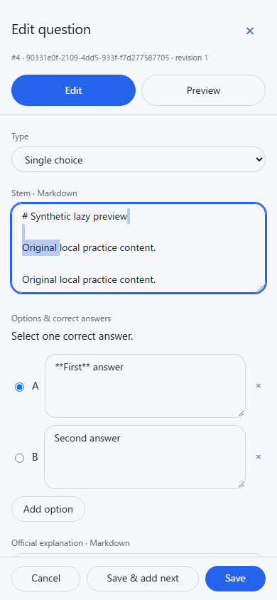

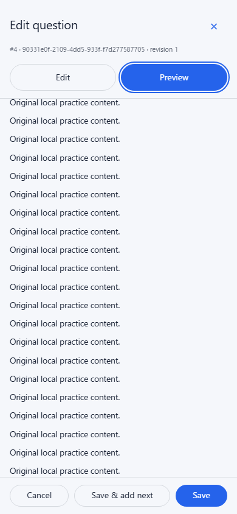

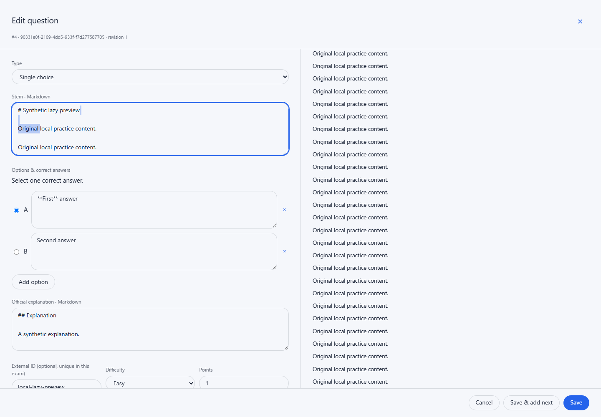

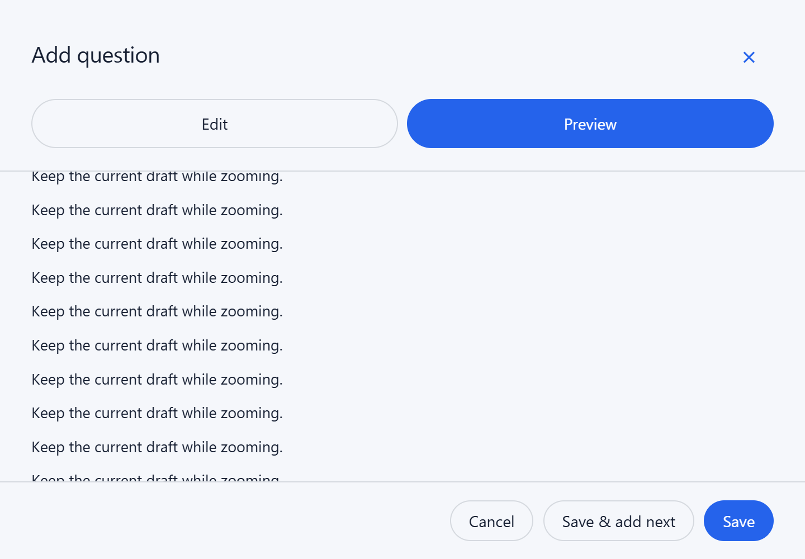

This correction is independent of component JSON diagnostics in #147. It changes
no API, schema, stored data or rendering output. Roll back with a reviewed revert
of the eventual squash commit.
