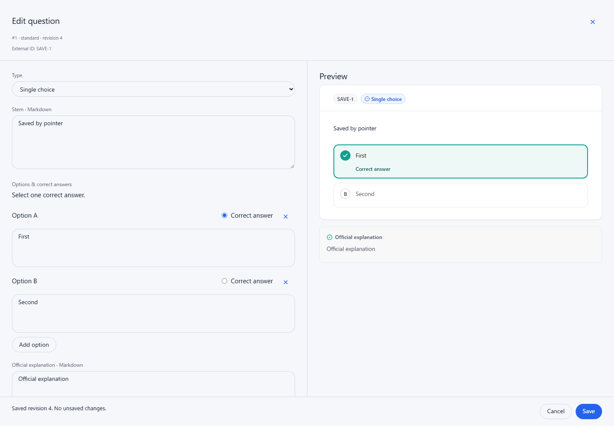
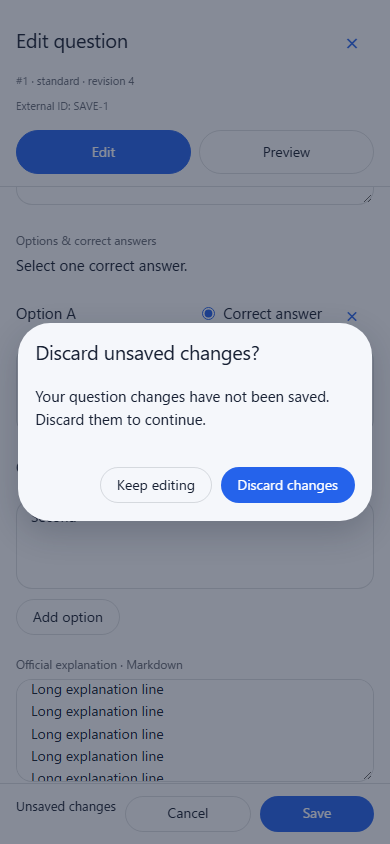

# Question save and discard workflow

[Documentation index](../README.md) · [Authoring guide](../guides/question-bank-authoring.md)

Issue [#151](https://github.com/YIzhongyue/PrepDeck/issues/151) adds visible dirty
state, Ctrl/Cmd+S, standard saves that keep an existing question open, and accessible
discard confirmation. The fixture uses the actual QuestionsPanel, editors and
PrepDeckProvider against synthetic loopback data. It never uses a deployed bank.

Reproduce with `node scripts/browser-regressions.mjs question-save-discard`.
Set `SCREENSHOT_DIR` to capture the two views below.

The regression checks keyboard and pointer saves, returned revisions, subsequent
dirty edits, delayed/failed/stale requests, validation, native unload protection,
confirmation keyboard trapping and exact field selection/scroll restoration.
Closing after saving returns focus to the current Edit control even when the
question-list refresh replaced the original button. The save status shares the
footer action row so short landscape layouts retain their editable pane.
Each of the six provider navigation entry points is cancelled and then resumed;
a second pending request and an unmounted editor cannot approve navigation.
Continuous creation and component close-on-save behavior are also exercised.
Companion authoring, preview and field-layout suites retain their original
diagnostic, Undo, stable-ID, responsive and lazy-preview assertions.

Run `node scripts/browser-regressions.mjs question-authoring-history` for the
actual Shell/router/Admin integration. Before the review corrections, repeated
Back followed by Keep editing caused the next Back to time out waiting for its
discard confirmation. Saving an Easy question as Hard under the Easy filter
also left focus on the body after closing. Both failures were reproduced in
this dedicated local fixture before production changes.

The corrected fixture covers repeated and reversed Back/Forward while a
decision is pending, cancellation and approval, and an extra native Forward
issued in capture phase while restoration is delivered. Both real pop indices
are asserted in Chromium and WebKit. Chromium also retains two tightly queued
restoration/Forward cases; WebKit can coalesce those queued calls, so it uses
the deterministic delivery cases instead. The checks verify URL, title and store
agreement, exact cancelled form contents, working subsequent navigation,
unchanged history length and zero authoring saves. A separate save case verifies
that the active filter stays unchanged and the Questions heading receives focus
when the saved row no longer matches. Existing matching rows still receive
focus on their current Edit control. Closing during a delayed list refresh
returns focus to the heading immediately; completing that refresh preserves
the user's deliberate focus on the search field.

Screenshots demonstrate local rendering; screen-reader speech was not verified.
